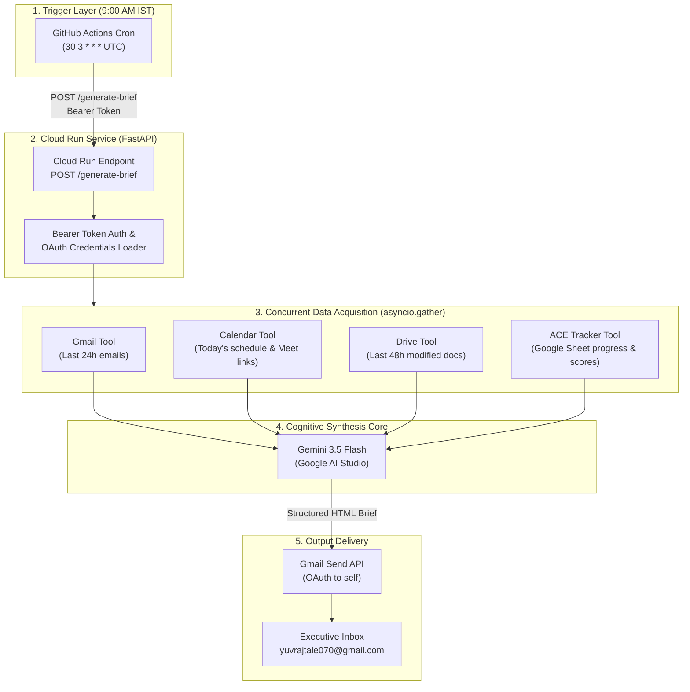
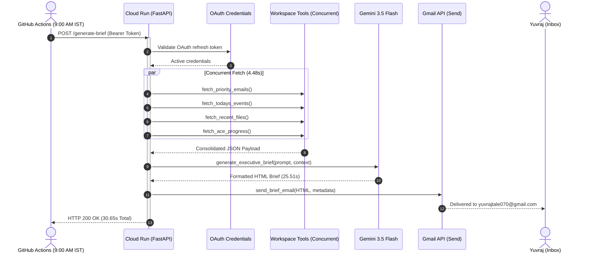

# 🧭 L&D Operations Copilot — Complete Walkthrough

Welcome to the architectural and operational walkthrough of **L&D Operations Copilot**. This document outlines how every component collaborates each morning to produce and deliver your personalized executive brief.

---

## 1. High-Level Architecture & Data Flow

---

## 2. Daily Executive Brief Structure

The brief generated every morning delivers 6 distinct intelligence sections:

| Section | Source Tool | Intelligence Delivered |
|---|---|---|
| 🔴 **Priority Emails** | `src/gmail_tool.py` | Categorized into **Urgent**, **Action Required**, and **FYI** with 1-line action items |
| 📅 **Meetings Today** | `src/calendar_tool.py` | Chronological schedule, attendees, and direct 1-click Google Meet links |
| 🎯 **Meeting Prep** | Multi-Tool Cross-Reference | Relevant Drive files, preparation agenda, and follow-up topics |
| 📚 **ACE Certification** | `src/ace_tracker.py` | Module progress gauge (e.g. 21.4%), lowest quiz scores, revision alerts, study duration |
| 📁 **Drive Intelligence** | `src/drive_tool.py` | Files modified in the last 48 hours, shared team docs, and meeting-linked assets |
| ⭐ **Top 5 Priorities** | `src/gemini_service.py` | Cross-functional priority checklist for your morning focus |

---

## 3. Step-by-Step Runtime Lifecycle

---

## 4. Real Verified Metrics

During the live test on your environment, the pipeline produced these verified metrics:

- **Total Execution Time**: **30.65 seconds**
- **Data Gathering**: 4.48s (concurrenly reading 5 emails, 3 calendar events, 7 drive files, 14 ACE modules)
- **Gemini 3.5 Flash Synthesis**: 25.51s (generating full HTML email template with custom CSS styling)
- **Gmail Delivery**: 0.66s (Message ID: `1a15dc542e0dae2f`)
- **Total Monthly Cost**: **$0.00**

---

## 5. Security & Zero-Secret-Manager Architecture

- **Zero Secret Manager cost**: Environment variables are passed directly into Cloud Run or loaded from `.env` locally.
- **Git Push Protection compliant**: `.env` and `client_secret.json` are excluded via `.gitignore`.
- **Bearer token protected**: Calls to `/generate-brief` require the secret `API_TRIGGER_TOKEN`.
- **Free tier optimization**: Fits completely within Google Cloud, Gemini, and GitHub Actions free tiers.

---

## 6. Google ADK (Agent Development Kit) Migration Map

When Google Agent Development Kit is adopted, the tools map 1:1:

| Current Component | Future ADK Equivalent | Description |
|---|---|---|
| `src/gmail_tool.py` | `@tool GmailTool` | Wrapped as an ADK Tool |
| `src/calendar_tool.py` | `@tool CalendarTool` | Wrapped as an ADK Tool |
| `src/drive_tool.py` | `@tool DriveTool` | Wrapped as an ADK Tool |
| `src/ace_tracker.py` | `@tool AceTrackerTool` | Wrapped as an ADK Tool |
| `src/brief_generator.py` | `DailyBriefAgent(LlmAgent)` | Top-level agent orchestrating tools |
