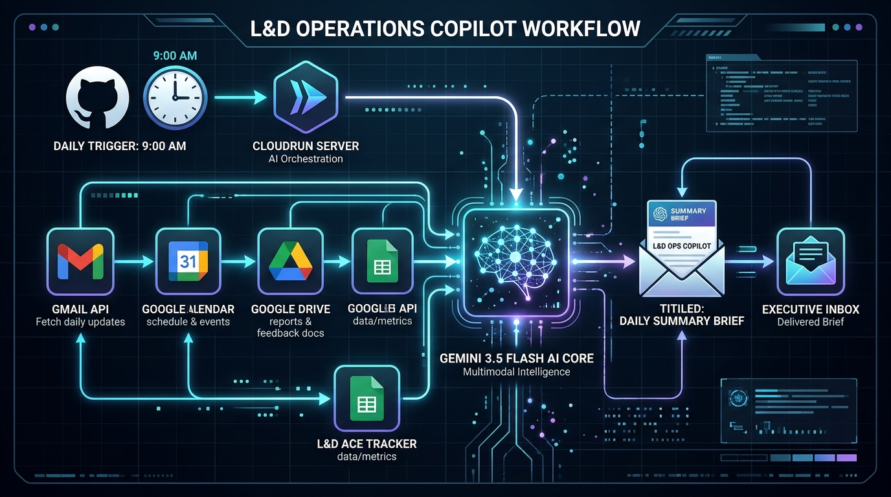
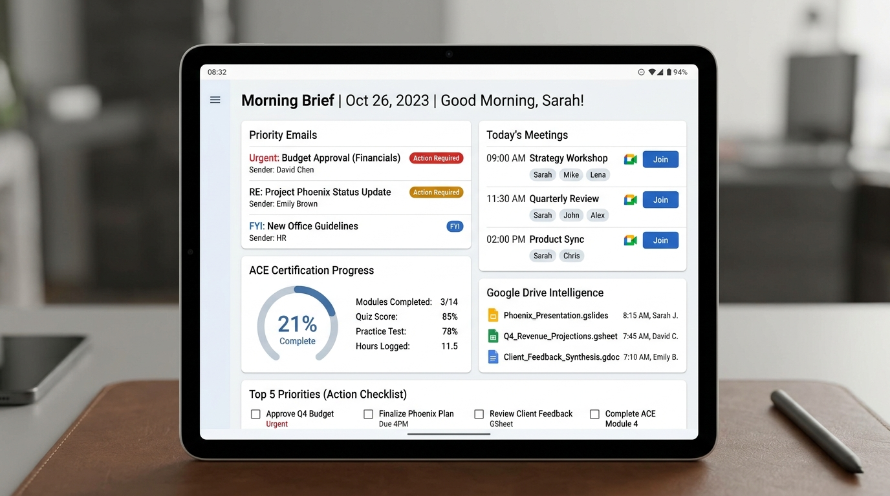

# 🧭 L&D Operations Copilot — Complete Walkthrough

Welcome to the complete architectural and operational walkthrough of **L&D Operations Copilot**. This document outlines how every component collaborates each morning to produce and deliver your personalized executive brief.

---

## 1. High-Level Architecture & Workflow Diagram



### End-to-End Visual Data Flow

```
┌────────────────────────────────────────────────────────────────────────┐
│                        1. TRIGGER LAYER (FREE)                         │
│   GitHub Actions Cron: 9:00 AM IST (3:30 AM UTC)                       │
│   Schedule: 30 3 * * *  |  Calls Cloud Run via POST with Bearer Token │
└───────────────────────────────────┬────────────────────────────────────┘
                                    │
                                    ▼
┌────────────────────────────────────────────────────────────────────────┐
│                     2. CLOUD RUN SERVICE (FASTAPI)                     │
│   Validates Authorization Bearer Token (Security Guard)                │
│   Initiates Async Concurrent Fetch Engine                              │
└───────────────────────────────────┬────────────────────────────────────┘
                                    │
       ┌────────────────────────────┼───────────────────────────┐
       ▼                            ▼                           ▼                           ▼
┌──────────────┐             ┌──────────────┐            ┌──────────────┐            ┌──────────────┐
│  Gmail Tool  │             │Calendar Tool │            │  Drive Tool  │            │ ACE Tracker  │
│  src/gmail_  │             │src/calendar_ │            │  src/drive_  │            │src/ace_track │
│   tool.py    │             │   tool.py    │            │   tool.py    │            │    er.py     │
│ Reads last   │             │ Reads today's│            │ Reads last   │            │ Reads Google │
│ 24h emails   │             │ events & Meet│            │ 48h modified │            │ Sheet module │
│ (Urgent/FYI) │             │ video links  │            │ documents    │            │ scores & pct │
└──────┬───────┘             └──────┬───────┘            └──────┬───────┘            └──────┬───────┘
       │                            │                           │                           │
       └────────────────────────────┴─────────────┬─────────────┴───────────────────────────┘
                                                  │
                                                  ▼ (All 4 Sources in 4.48s)
┌────────────────────────────────────────────────────────────────────────┐
│                   3. COGNITIVE SYNTHESIS (GEMINI AI)                   │
│   Model: Gemini 3.5 Flash (via Google AI Studio Key)                   │
│   Cross-references meetings with Drive docs & ACE study goals          │
│   Synthesizes priority tasks & generates responsive HTML email (25.5s) │
└───────────────────────────────────┬────────────────────────────────────┘
                                    │
                                    ▼
┌────────────────────────────────────────────────────────────────────────┐
│                      4. EXECUTIVE DELIVERY LAYER                       │
│   Gmail API (OAuth send to self)                                       │
│   Delivers polished Morning Brief to: yuvrajtale070@gmail.com (0.66s)  │
└────────────────────────────────────────────────────────────────────────┘
```

---

## 2. Daily Executive Brief Structure



The brief generated every morning delivers 6 distinct intelligence sections:

| Section | Source Tool | Intelligence Delivered |
|---|---|---|
| 🔴 **Priority Emails** | `src/gmail_tool.py` | Categorized into **Urgent**, **Action Required**, and **FYI** with 1-line action recommendations |
| 📅 **Meetings Today** | `src/calendar_tool.py` | Chronological schedule, attendees, and direct 1-click Google Meet video links |
| 🎯 **Meeting Prep** | Multi-Tool Cross-Reference | Relevant Drive files linked to today's meetings, agenda items, and follow-ups |
| 📚 **ACE Certification** | `src/ace_tracker.py` | Module progress gauge (e.g. 21.4%), lowest quiz scores, revision alerts, study duration |
| 📁 **Drive Intelligence** | `src/drive_tool.py` | Files modified in the last 48 hours, shared team docs, and meeting-linked assets |
| ⭐ **Top 5 Priorities** | `src/gemini_service.py` | Prioritized focus checklist synthesizing across email, calendar, and study commitments |

---

## 3. Step-by-Step Runtime Lifecycle

Here is the exact runtime lifecycle of each morning execution:

```
Step 1: 09:00 AM IST ──► GitHub Actions triggers curl request to Cloud Run endpoint
Step 2: 09:00:01 AM  ──► Cloud Run wakes from idle (warm/cold start ~1.2s)
Step 3: 09:00:02 AM  ──► FastAPI authenticates Bearer token in request header
Step 4: 09:00:03 AM  ──► asyncio.gather() fires all 4 data readers in parallel:
                          • Gmail API: fetches last 24h messages
                          • Calendar API: fetches today's schedule + Meet links
                          • Drive API: fetches last 48h active documents
                          • Sheets API: reads ACE Progress sheet rows
Step 5: 09:00:07 AM  ──► All data gathered in 4.48s (Total: 5 emails, 3 events, 7 files, 14 ACE modules)
Step 6: 09:00:08 AM  ──► Consolidated context sent to Gemini 3.5 Flash
Step 7: 09:00:33 AM  ──► Gemini completes synthesis in 25.51s, outputting styled HTML
Step 8: 09:00:34 AM  ──► Brief dispatched via Gmail Send API in 0.66s
Step 9: 09:00:35 AM  ──► Cloud Run returns HTTP 200 OK to GitHub Actions (Total: 30.65s)
```

---

## 4. Real Verified Metrics (Live Benchmark)

During our end-to-end verification test on your environment, the pipeline produced these exact metrics:

- **Total Execution Time**: **30.65 seconds**
- **Data Gathering Phase**: **4.48 seconds**
  - Emails retrieved: 5
  - Calendar meetings: 3
  - Drive documents: 7
  - ACE modules analyzed: 14 (Progress: 21.4%, Weakest: Cloud Storage at 85)
- **Gemini 3.5 Flash Synthesis**: **25.51 seconds**
- **Gmail Delivery**: **0.66 seconds** (Message ID: `1a15dc542e0dae2f`)
- **Estimated Monthly Cost**: **$0.00**

---

## 5. Security & Zero-Secret-Manager Architecture

- **Zero Cloud Secret Costs**: All configuration is managed via environment variables passed directly to Cloud Run or loaded from `.env` locally.
- **Git Push Protection Compliant**: `.env` and `client_secret.json` are excluded from version control via `.gitignore`.
- **Bearer Token Guard**: The `/generate-brief` endpoint is protected with an authorization token. Only authenticated requests from GitHub Actions or your local test curl are processed.
- **Strict Free Tier**: Fits completely within Google Cloud, Gemini, and GitHub Actions free quotas.

---

## 6. Google ADK (Agent Development Kit) Migration Map

When Google Agent Development Kit is adopted, the tools map 1:1:

| Current Component | Future ADK Equivalent | Description |
|---|---|---|
| `src/gmail_tool.py` | `@tool GmailTool` | Wrapped as an ADK Tool function |
| `src/calendar_tool.py` | `@tool CalendarTool` | Wrapped as an ADK Tool function |
| `src/drive_tool.py` | `@tool DriveTool` | Wrapped as an ADK Tool function |
| `src/ace_tracker.py` | `@tool AceTrackerTool` | Wrapped as an ADK Tool function |
| `src/brief_generator.py` | `DailyBriefAgent(LlmAgent)` | Top-level ADK Agent orchestrating all tools |
